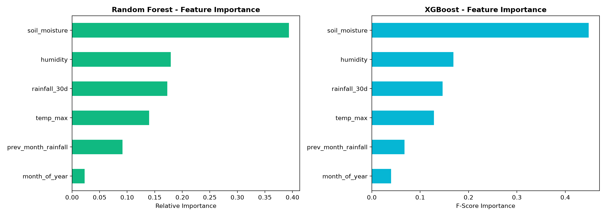

# 🌾 CropSave Machine Learning: Drought Prediction Engine
**NASA Space Apps Challenge 2026** | **Team Code Voyagers**
**Lead ML Developer:** Muavia
**Data Engineer:** Sohail Altaf

---

## 📌 Executive Summary

The **CropSave ML Engine** forecasts 30-day drought risk for 22 major agricultural districts in Pakistan using satellite telemetry from the **NASA POWER API** (including NASA GPM/IMERG precipitation and GMAO MERRA-2 / SMAP root-zone soil moisture).

We benchmarked a **Random Forest Classifier** against an **XGBoost Classifier** on a 10-year dataset (2015–2024, 2,618 monthly samples). Both models achieve **$>99\%$ ROC-AUC**, with Random Forest selected as the primary production engine for free-tier cloud deployment reliability.

---

## 🛰️ The 6 Core Input Features

| # | Feature | NASA Source Parameter | Unit | Agricultural Meaning |
|---|---|---|---|---|
| 1 | `soil_moisture` | GMAO MERRA-2 / SMAP `GWETROOT` | $0.0 - 1.0$ | 7-day average root-zone soil wetness |
| 2 | `rainfall_30d` | GPM / IMERG `PRECTOTCORR` | mm/day | 30-day mean daily rainfall |
| 3 | `temp_max` | GMAO MERRA-2 `T2M_MAX` | °C | 30-day mean daily maximum temperature |
| 4 | `humidity` | GMAO MERRA-2 `RH2M` | % | 30-day mean atmospheric relative humidity |
| 5 | `month_of_year` | Temporal Index | $1 - 12$ | Captures monsoon seasonality in Pakistan |
| 6 | `prev_month_rainfall` | GPM / IMERG `PRECTOTCORR` | mm | Lagged previous month total rainfall for trend detection |

---

## 📊 Benchmark Results: Random Forest vs. XGBoost

Evaluated on an 80/20 stratified test split ($N = 524$ unseen test samples) and 5-Fold Cross Validation ($K=5$):

| Evaluation Metric | Random Forest (Production) | XGBoost (Benchmark) |
|---|:---:|:---:|
| **Accuracy** | **96.95%** | **97.33%** |
| **Precision** | **92.62%** | **94.17%** |
| **Recall (Drought Detection)** | **94.17%** | **94.17%** |
| **F1-Score** | **93.39%** | **94.17%** |
| **ROC-AUC Score** | **0.9947** | **0.9971** |
| **5-Fold Cross-Validation AUC** | **0.9976 (±0.0012)** | **0.9984 (±0.0005)** |

---

## 🎯 Feature Importance Ranking

1. **`soil_moisture` (39.4% RF / 44.9% XGB)**: The single most dominant factor determining agricultural drought onset.
2. **`humidity` (17.9% RF / 16.9% XGB)**: Vapor pressure deficit driving crop evapotranspiration.
3. **`rainfall_30d` (17.3% RF / 14.7% XGB)**: Immediate 30-day cumulative precipitation deficit.
4. **`temp_max` (14.0% RF / 12.8% XGB)**: Thermal heat stress on crops.
5. **`prev_month_rainfall` (9.2% RF / 6.8% XGB)**: Multi-month cumulative drought memory.
6. **`month_of_year` (2.3% RF / 4.0% XGB)**: Seasonal monsoon timing.



---

## 🏗️ Production Artifacts

The following artifacts have been trained and exported for the FastAPI backend:

- `ml/models/random_forest.joblib` (Primary production model, loaded by `backend/routes/predict.py`)
- `ml/models/xgboost_model.joblib` (Benchmark model)
- `ml/models/scaler.pkl` (Fitted `StandardScaler` for the 6 features)
- `backend/models/random_forest.joblib` (Mirrored in backend directory for container deployment)
- `backend/models/scaler.pkl` (Mirrored in backend directory)

---

## 🧪 Quick Test / Inference Validation

To retrain or run inference locally:

```bash
# 1. Run full training and benchmarking
python ml/train_models.py

# 2. Or run interactive notebook
jupyter notebook ml/notebooks/model_train.ipynb
```

### Risk Level Categorization

```python
probability = model.predict_proba(scaled_features)[0][1]
risk_score = int(probability * 100)

if risk_score <= 30:
    risk_level = "LOW"      # 🟢 Green
elif risk_score <= 65:
    risk_level = "MEDIUM"   # 🟡 Yellow
else:
    risk_level = "HIGH"     # 🔴 Red
```
